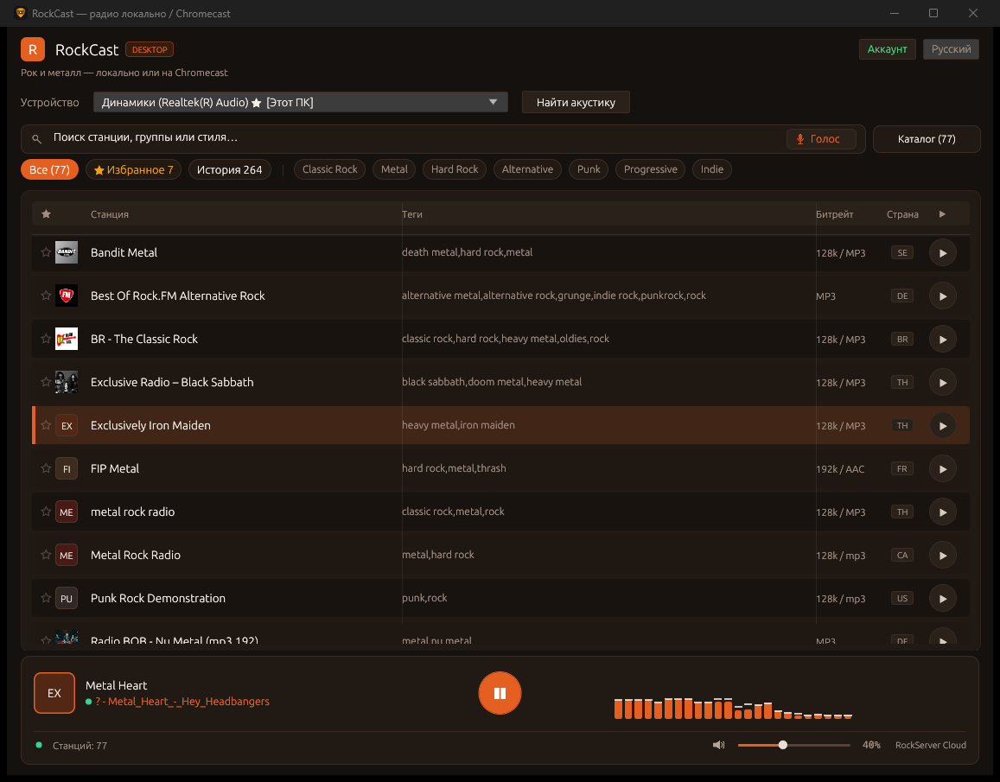

# RockCast

Desktop internet radio player for Windows and Linux. Play rock / metal streams on **PC speakers** or on **Google Cast** devices (Chromecast, Cast-enabled speakers such as JBL) using a native CASTV2 client — no Chrome browser required.



## Ecosystem

RockCast is part of the RockCast internet radio suite:

- **[RockCast](https://github.com/morozov11/rockcast)** *(this repository)* — Desktop internet radio player for Windows & Linux with Google Cast (CASTV2), local playback, and spectrum visualizer.
- **[RockMobile](https://github.com/morozov11/rockmobile)** — Android companion app and radio player with background playback and remote device control.
- **[RockServer](https://github.com/morozov11/rockserver)** — Rust backend for radio discovery, AI semantic search, streaming voice recognition, and device sync ([rockplatform.win](https://rockplatform.win)).
- **[rock-esp32](https://github.com/morozov11/rock-esp32)** — Standalone hardware radio player and display firmware based on ESP32-P4.
- **[RockCast Station Catalog](https://github.com/morozov11/rockcast-station-catalog)** — Curated baseline station catalog, JSON schema, and offline validation tools.

## Features

- **Local playback** — decode and play HTTP(S) radio streams on your PC (cpal + symphonia)
- **Google Cast** — discover receivers and stream live radio to one selected receiver per playback session via CASTV2 (TLS + protobuf)
- **Via PC relay** — always enabled for Cast: PC receives the authenticated RockServer proxy stream and serves it to the speaker on LAN
- **VPN-friendly discovery** — mDNS plus a LAN `/24` TCP scan with Cast `eureka_info` (works when Amnezia / WireGuard breaks multicast)
- **Station catalog** — server-driven catalog loaded directly from RockServer (<300 ms) with rock station priority; search and infinite scroll across the entire database of 16,000+ stations
- **Station icons** — loaded strictly from RockServer (`/api/v1/stations/{id}/icon`, WebP) when `faviconUrl` is provided by the server (matching rock-esp32 and RockMobile); third-party homepages are not scraped, no blind 404 requests, fallback to monogram placeholders
- **Now playing** — ICY / Shoutcast `StreamTitle` when the station provides metadata, shown with a green live dot and an animated equalizer on the playing row; the observed title is also published to the account-owned RockServer device directory for RockMobile
- **Rock-styled UI** — 44 px station rows with always-visible round play buttons, filter/genre chips, a unified player deck (station art, transport button on the panel axis, full-height clickable spectrum, volume in the status footer) and a card-style «Account & devices» window; design references live in `design/mockups/`
- **Spectrum visualizer** — optional FFT bars (uses the same local decode path or a stream tap for Cast)
- **Bilingual UI** — Russian and English
- **Persistent settings** — volume, last station, device, language, spectrum toggle
- **RockServer integration** — official releases use the public production service automatically for catalog loading, search, voice recognition, and stream proxying; audio requires an account session and RockServer connectivity

## Requirements

- Windows 10 / 11, or Linux (X11 or Wayland; audio via ALSA / PipeWire)
- [Rust](https://rustup.rs/) toolchain 1.98.0 (edition 2024)
- Same Wi‑Fi / LAN as your Cast device for casting
- Optional: Amnezia or other VPN — Cast discovery still works via subnet scan if LAN unicast is allowed

### Linux packages (Fedora / Kinoite distrobox)

Build the GUI and cpal against system libraries:

```bash
sudo dnf install gcc gcc-c++ make pkgconf-pkg-config \
  alsa-lib-devel libxkbcommon-devel wayland-devel \
  libX11-devel libXcursor-devel libXrandr-devel libXi-devel mesa-libGL-devel
```

On Fedora Kinoite keep the toolchain in rustup (`~/.cargo`) inside toolbox/distrobox — do not layer `rust`/`cargo` with `rpm-ostree`.

Debian/Ubuntu equivalents: `build-essential pkg-config libasound2-dev libxkbcommon-dev libwayland-dev libx11-dev libxcursor-dev libxrandr-dev libxi-dev libgl1-mesa-dev`.

## Quick start

Windows:

```bat
run.bat
```

Linux:

```bash
./run.sh
```

Or manually:

```bash
cargo run --release
```

Debug build:

```bash
cargo run
```

Logging (default level `info`):

```bash
# Windows
set RUST_LOG=info
cargo run --release

# Linux / macOS
RUST_LOG=info cargo run --release
```

Useful levels: `rockcast=debug`, `rockcast::cast::discovery=debug`.

## Using the app

Detailed Russian-language instructions, including voice commands: **[docs/user-manual.html](docs/user-manual.html)**. Open the file in a browser.

1. **Wait for stations** — the catalog loads directly from RockServer on startup; search and voice find more stations across the catalog.
2. **Find devices** — click **Find** to scan PC audio outputs and Cast receivers on the LAN.
3. **Select output** — choose **This PC** (speakers) or a Cast device (e.g. a JBL speaker).
4. Cast always uses RockServer → PC → one selected speaker over Wi-Fi. Local playback also reads the RockServer proxy. Sign in to your Rock account before starting radio.
5. **Select a station** — click a row; the round ▶ button on the row (or a double-click) starts playback immediately. The playing row is highlighted with an accent bar and an animated equalizer next to the name.
6. **Play / Stop** — the large accent button in the player deck starts the selected station and stops the live stream; every row has its own play/pause control too.
7. **Volume** — thin slider in the deck footer (speaker icon = mute/unmute); Cast volume is scaled so the UI “100%” maps to a comfortable speaker level.
8. **Spectrum** — click the spectrum bars themselves to enable/disable the equalizer-style visualizer (extra network use when casting).
9. **Search** — type to filter the catalog; the embedded button becomes «Найти» (Enter also submits). With an empty field the same button is «Голос» — voice input (click or Enter).
10. **Account** — «Аккаунт» opens the account & devices card: this PC's session, other paired devices with last-seen times, refresh and logout.
11. **Language** — switch Russian / English from the UI; the choice is saved.

### Cast notes

- Discovery runs **mDNS** (`_googlecast._tcp`) on the real LAN NIC and, in parallel, a **unicast scan** of `x.x.x.1–254` for TCP **8009**, then reads `http://<ip>:8008/setup/eureka_info`.
- Split-tunnel VPN exclusions often fix unicast but **not** multicast; the subnet scan is what finds devices like JBL when mDNS returns nothing.
- Playback on Cast uses CASTV2: connect → launch Default Media Receiver → `LOAD` the live stream URL.
- `LOAD` always points at `http://<PC-LAN-IP>:<port>/stream`; the PC reads `/api/v1/stations/{id}/stream` from RockServer with its native-session bearer token. Allow inbound LAN (Windows Firewall / firewalld) if prompted.
- RockCast controls one selected receiver per playback session; discovering multiple receivers does not enable simultaneous playback. The temporary LAN relay accepts at most two clients total (the Cast stream and optional spectrum tap), rejects additional clients with HTTP 503, and has no client authentication. Use it only on a trusted LAN.

### Local playback notes

- Uses the selected output device (or the system default): WASAPI on Windows, ALSA (PipeWire/Pulse) on Linux.
- Supports common stream codecs handled by symphonia (MP3, AAC, Ogg/Vorbis, FLAC, etc., depending on the station).
- Track titles come from ICY metadata when available.

## Control from RockMobile

Pair this RockCast with the same [RockServer](https://github.com/morozov11/rockserver) account as [RockMobile](https://github.com/morozov11/rockmobile), then select the online desktop in the phone's Devices screen. Station selections on the phone reach RockCast through device-control commands. RockCast publishes confirmed playback state and an optional current track title from ICY metadata; the phone resolves the station name through RockServer. A station without stream metadata has no track title.

## Station catalog

RockCast uses a 100% server-driven station catalog loaded directly from [RockServer](https://github.com/morozov11/rockserver)
([rockplatform.win](https://rockplatform.win)), following the same architecture as [rock-esp32](https://github.com/morozov11/rock-esp32)
and [RockMobile](https://github.com/morozov11/rockmobile).

On startup, RockCast fetches initial station pages (<300 ms response time) prioritized for rock and metal
stations. The user can browse with infinite scroll pagination or search across the entire database of
16,000+ stations via text search and voice commands. There is no bundled local JSON catalog or offline fallback list.

### Station icons

Station icons load strictly from RockServer (`/api/v1/stations/{id}/icon`, WebP) when `faviconUrl` is
provided in station metadata from the server. Third-party station homepages are not scraped, conventional
`/favicon.ico` guesses are eliminated, and blind 404 network requests are avoided. When `faviconUrl` is
null or empty, RockCast renders a clean letter monogram placeholder.

Downloaded WebP icons are decoded and cached in the platform app-data directory under `station-icons`
so subsequent launches display station artwork without network round-trips.


## Settings

Stored at:

```text
Windows: %LOCALAPPDATA%\RockCast\settings.json
Linux:   ~/.config/rockcast/settings.json
```

Typical fields: `volume`, `station_url`, `last_played_station`, `device_id`, `eq_enabled`, and `language`. RockServer endpoint and credentials are not user settings. The former `cast_relay` field is ignored when loading old settings and is omitted from new saves; direct Cast mode is removed.

## RockServer and voice control

Official RockCast releases use the production [RockServer](https://github.com/morozov11/rockserver) at [rockplatform.win](https://rockplatform.win) automatically. Public station search calls `POST /api/v1/search` without an Authorization header. The window has no RockServer URL or token controls, and these values are not saved in ordinary user settings. RockCast loads its catalog directly from the public RockServer API. Both local and Cast audio require an authenticated RockServer stream; there is no direct-upstream fallback.

The **Voice** button records PCM16 mono from the default microphone until release, detected silence, or the 45-second recording limit, then connects to `wss://rockplatform.win/api/v1/voice/stream` ([rockplatform.win](https://rockplatform.win)) over TLS. The official runtime uses the compatible buffered SpeechKit v1 request. Input-device selection/testing and cancellation after upload begins are not implemented yet.

For local development and tests, debug builds alone accept `ROCKCAST_DEV_ROCKSERVER_URL`. A Bearer-protected development server can additionally use `ROCKCAST_DEV_ROCKSERVER_BEARER_TOKEN`, and `ROCKCAST_DEV_ROCKSERVER_VOICE_MODE=streaming_v3` selects streaming capture. These runtime-only overrides are ignored by release builds, never written to settings, never shown in the UI, and their values are not logged.

### Voice commands

RockServer recognizes station requests in Russian and English. RockCast additionally recognizes these short control commands locally after receiving the transcript:

| Russian | English | Action |
| --- | --- | --- |
| `Стоп`, `Останови`, `Выключи` | `Stop`, `Pause`, `Turn off` | Stop playback. |
| `Дальше`, `Следующая`, `Вперёд` | `Next`, `Next station`, `Skip` | Select and play the next station in the current list. |
| `Назад`, `Предыдущая` | `Previous`, `Previous station`, `Back` | Select and play the previous station in the current list. |
| `Включи музыку` | `Play music`, `Play some music` | Play the last station that started successfully. The station is remembered across restarts. |

At the beginning or end of a list, **Previous** or **Next** does not wrap around. If no station has played successfully yet, **Play music** leaves playback unchanged.

## Project layout

```text
rockcast/
├── Cargo.toml
├── assets/               # app icon + embedded UI icon PNGs (see scripts/generate_icons.py)
├── design/mockups/       # approved UI redesign mockups (HTML)
├── run.bat               # Windows release launcher
├── run.sh                # Linux release launcher
├── docs/                 # architecture & agent-oriented code docs
├── proto/                # Cast channel protobuf reference
├── examples/
│   └── cast_probe.rs     # CLI discovery probe
└── src/
    ├── main.rs           # GUI entry
    ├── lib.rs
    ├── app/              # egui UI (theme, actions, ui panels)
    ├── playback/         # PlaybackController + phase/volume
    ├── runtime.rs        # bounded background job executors
    ├── local/            # PC playback (cpal + decode)
    ├── observers/        # ICY + spectrum taps for Cast
    ├── stations/         # station models and sorting
    ├── audio/            # stream decoding, format detection, spectrum math
    ├── relay/            # LAN HTTP relay PC → Cast
    ├── voice/            # RockServer voice search
    ├── rockserver.rs     # RockServer API and stream configuration
    ├── station_icons.rs  # RockServer icon fetch and cache
    ├── session.rs        # paired account session and credentials
    ├── session/          # token, pairing, OS credential storage
    ├── device_control.rs # RockServer device-control lifecycle
    ├── device_control/   # protocol, transport, receiver handles, tests
    ├── personal_data/    # local favourites and playback history
    ├── personal_sync/    # favourites/history sync with RockServer
    ├── playback_diag/    # optional playback diagnostics
    ├── i18n.rs           # EN / RU strings
    ├── output.rs         # local + Cast device list
    ├── telemetry.rs      # UI telemetry snapshots
    ├── settings.rs
    └── cast/
        ├── discovery/    # mDNS + subnet scan
        ├── client/       # CASTV2 play / stop / volume
        ├── channel/      # TLS framing + auth
        │   ├── recv.rs   # read loop / inbox
        │   └── tls.rs    # connect
        └── proto.rs      # hand-rolled CastMessage codec
```

Code architecture, module map, playback/Cast flows, and notes for AI coding agents: **[docs/README.md](docs/README.md)**.

## Development

### Build

```bash
cargo build --release
```

Binary: `target/release/rockcast.exe` (Windows) or `target/release/rockcast` (Linux).

### Tests

```bash
cargo test --lib
```

Discovery tests include VPN interface name filters and a live probe of `192.168.31.109:8009`; the probe returns early when that address is unavailable. It is specific to the developer's LAN and is not a general discovery test.

### Cast discovery probe

```bash
cargo run --example cast_probe
```

Prints every Cast receiver found via mDNS and/or subnet scan (about 8 seconds).

### Architecture (short)

| Path | Role |
|------|------|
| UI thread (egui) | Renders UI; starts background work for scan / play / stop |
| `LocalPlayer` | HTTP stream → decode → ring buffer → cpal output + optional FFT |
| `CastService` | CASTV2 session, heartbeat, volume, `LOAD` / `STOP` |
| `StreamRelay` | Mandatory Cast relay: authenticated RockServer stream -> PC -> Cast LAN URL |
| Discovery | LAN NIC whitelist (skip Amnezia/Hyper-V/…) + mDNS + `/24` TCP probe |

## Troubleshooting

| Symptom | What to try |
|---------|-------------|
| No Cast devices | Click **Find** again; ensure PC and speaker are on the same LAN; allow LAN in VPN; run `cargo run --example cast_probe` |
| Cast found, play fails | Confirm the station URL plays on PC first; check firewall for outbound HTTPS to the stream and TCP 8009 to the device |
| Silent on JBL | Check RockServer sign-in and availability; allow inbound LAN (Windows Firewall / firewalld); PC and JBL on same Wi‑Fi |
| Empty station list | Check internet connectivity and RockServer status |
| No track title | Many stations do not send ICY metadata |
| Wrong PC audio device | Pick another entry under **Device** after **Find** |
| Spectrum silent on Cast | Enable spectrum; Cast mode uses a separate stream tap after the receiver starts |

## License

RockCast is licensed under the [Apache License, Version 2.0](LICENSE).

## Acknowledgments

- [SomaFM](https://somafm.com/), Rock Antenne, and other listed stations — streams referenced in the default catalog
- Google Cast / CASTV2 protocol community documentation
